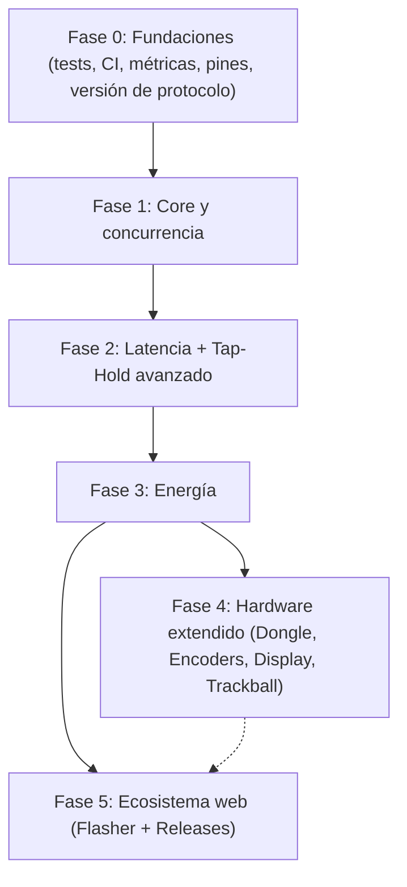
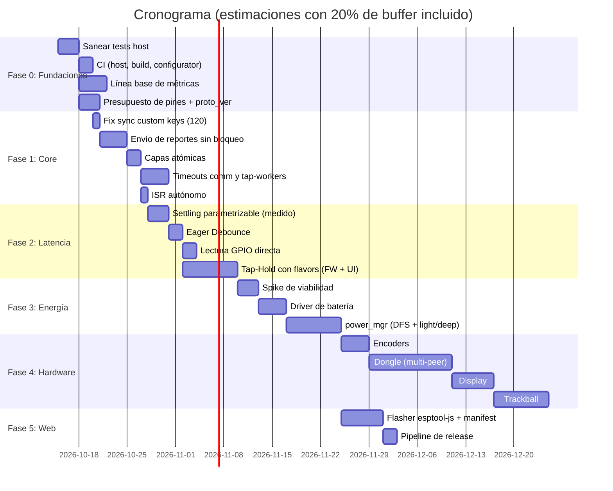

# Plan Integral de Implementación: Evolución Arquitectónica del Firmware (TEF)

> **Documento:** `FIRMWARE_EVOLUTION_IMPLEMENTATION_PLAN.md`  
> **Estado:** Revisado v2 — pendiente de aprobación  
> **Rama de Trabajo:** `firmware-evolution`  
> **Plataforma Objetivo:** ESP32-S3 (Xtensa dual-core, **ESP-IDF 6.0.2** — ver `sdkconfig` y `main/idf_component.yml` que exige `idf >= 6.0`) & Configurator (React 19 / Vite / TS)  
> **Fecha:** Octubre 2026

---

## 0. Registro de Revisión (qué cambió respecto a v1 y por qué)

Cada afirmación del plan original fue contrastada contra el código. Resumen de hallazgos que **cambian el diseño**:

| # | Afirmación en v1 | Realidad verificada en el repo | Consecuencia en v2 |
|---|---|---|---|
| R1 | Toolchain ESP-IDF v5.5, CI con `espressif/idf:v5.5` | `sdkconfig` = **IDF 6.0.2**; `main/idf_component.yml` pide `idf >= 6.0` | CI y APIs (ADC, GPIO) se planifican para IDF 6.x |
| R2 | Flashear app en `0x10000` | [`partitions.csv`](file:///home/srleg/Projects/Tecleados-ESP-Firmware/partitions.csv): app `factory` en **`0x90000`**, NVS `0x9000` (512 KB), **sin particiones OTA** | Offsets se leen de `flasher_args.json`, nunca hardcodeados; se evalúa OTA (§5.1) |
| R3 | "Liberar >9 KB de DRAM interna" al unificar tap-workers | Las 4 tareas `kb_tap_*` se crean con `MALLOC_CAP_SPIRAM` ([`kb_macro.c#L611-L613`](file:///home/srleg/Projects/Tecleados-ESP-Firmware/components/keyboard/kb_macro.c#L611-L613)); solo `comm_timeout_task` (4 KB) está en DRAM interna | Ahorro real: ~4 KB DRAM + ~12 KB PSRAM. Prioridad baja |
| R4 | Mailbox `xQueueOverwrite` de `kb_report_payload_t` | El reporte se arma **desde el estado compartido** `s_v_nkro` en `kb_macro_send_report()`; lo llaman `kb_manager`, `macro_task`, `tap_worker` y `kb_custom_key` | Mailbox de payload es innecesario y puede perder un *press* corto; se usa notificación + snapshot (§1.2) |
| R5 | El split sync de custom keys solo requiere subir cota a 120 y agregar `vTaskDelay` cada 8 paquetes | El push ya es **stop-and-wait con ACK** (`on_ack`, sem de TX); la cota `64` es real (macros `64` y combos `32` también están hardcodeados) | Fix de 3 líneas + constantes; **no** agregar delays |
| R6 | "Estado actual: 36 % de CPU" por settling | Cierto **solo mientras hay teclas activas**; en reposo se usa ISR + `ulTaskNotifyTake` | Objetivos de CPU recalculados (§2.1) |
| R7 | Reducir settling a 5–8 µs "porque es seguro" | El propio comentario de [`kb_matrix.c#L77`](file:///home/srleg/Projects/Tecleados-ESP-Firmware/components/keyboard/kb_matrix.c#L77) calcula ~13 µs de constante RC | Se hace **parametrizable y medido con osciloscopio**, no fijado a ciegas |
| R8 | `GPIO.in1.data` + dos máscaras (low/high) | Filas = GPIO1–6, todas en el banco bajo (<32) | Basta una lectura de `GPIO.in`/`GPIO_IN_REG`; no hace falta `in1` |
| R9 | `esp_adc_cal_characterize` | API legacy eliminada; en S3 se usa `adc_cali_create_scheme_curve_fitting` | Corregido (§3.1) |
| R10 | Pin ADC "ADC1" sin especificar | **GPIO1–10 (todo ADC1) están ocupados por la matriz**; ADC2 (GPIO11–20) también (11–18 matriz, 19/20 USB) | Bloqueante de hardware → decisión previa en Fase 0 |
| R11 | Divisor 100 kΩ/100 kΩ | Drena 4.2 V/200 kΩ ≈ **21 µA** ≈ todo el presupuesto de Deep Sleep (<20 µA) | Divisor de alta impedancia o gateado (§3.1) |
| R12 | "BAS y telemetría split por implementar" | BAS **ya existe** ([`ble_hid_service.c`](file:///home/srleg/Projects/Tecleados-ESP-Firmware/components/ble_module/ble_hid_service.c) read + `ble_hid_notify_battery_level`), y `split_protocol.h` ya tiene `battery_pct` (heartbeat en `split_task.c#L249`) | El driver ADC reemplaza el símbolo `weak`; el resto es cableado |
| R13 | Wake de light-sleep por GPIO "negedge", "<10 µs" | En light sleep el wake por GPIO es **por nivel** (`gpio_wakeup_enable(..., LOW_LEVEL)`); la latencia es ~cientos de µs–ms (hay `ESP_SLEEP_WAIT_FLASH_READY_EXTRA_DELAY=2000`) | Rediseño del wake y de las métricas (§3.2) |
| R14 | ESP-NOW con "DTIM" en light sleep | ESP-NOW no tiene AP/DTIM; requiere `esp_now_set_wake_window` + intervalo de wake sincronizado. Además `CONFIG_BT_CTRL_MODEM_SLEEP` está **deshabilitado** hoy | Spike de viabilidad previo (§3.0) |
| R15 | Dongle con "ESP32-C3 o S3 Mini" y endpoints USB HID | El **C3 no tiene USB OTG** (solo USB-Serial-JTAG): no puede ser dispositivo HID | Solo S3 (o S2). Además `splitmod` soporta **un único peer** |
| R16 | Dongle = "sub-proyecto ligero" | Layers, macros, combos, custom keys y config viven en el *master* | El dongle es una **variante de build del master** (§4.1) |
| R17 | Ejemplo de display Sharp LS027B7DH01 | Es un panel de 2.7" (400×240), no apto para un teclado; el de Nice!View es LS011B7DH03 (160×68) | Corregido (§4.4) |
| R18 | "Home-row mods" desde cero con *Permissive Hold* **y** *Hold-on-other-key-press* | Ya existen engine tap/hold/double-tap ([`kb_system_action.c`](file:///home/srleg/Projects/Tecleados-ESP-Firmware/components/keyboard/kb_system_action.c)) y `CKEY_MODE_MULTI_ACTION`; ambas reglas son **flavors excluyentes**, no complementarios | Se audita lo existente y se agrega un resolvedor *interrupt-aware* (§2.4) |
| R19 | Tests y CI al final (Fases 5.2/5.3) | `test/run_tests.sh` falla hoy en el primer `#include` (`event_bus.h` no encontrado; faltan `-I../components/...`) | **Se adelantan a Fase 0**: sin red de seguridad no se debe tocar el núcleo |
| R20 | Mouse HID ya disponible en el dongle ("Endpoint HID 2") | [`usb_descriptors.h`](file:///home/srleg/Projects/Tecleados-ESP-Firmware/components/usb_module/include/usb_descriptors.h) solo define teclado + consumer | Mouse HID (USB **y** BLE report map) es trabajo nuevo (§4.5) |
| R21 | `atomic_uint_least16_t` | Xtensa solo tiene `S32C1I` nativo de 32 bits; atomics de 16 bits caen en emulación con spinlock; además `kb_macro_get_layer_mask()` **escribe** (limpia capas borradas) siendo un getter | `_Atomic uint32_t` + CAS (§1.3); tests host pasan a `-std=c11` |

---

## 1. Visión y Objetivos

TEF ya cuenta con USB NKRO, BLE multi-perfil (NimBLE), enlace split cifrado sobre ESP-NOW (X25519 + AES-128-CCM), protocolo *Blast+Reconcile* y un configurador web. El objetivo es llevarlo a un producto *daily-driver wireless* / *gaming-grade* en **6 fases secuenciales, cada una entregable y reversible**:

### Principios rectores
1. **Medir antes de optimizar**: cada optimización tiene una métrica base capturada en Fase 0.
2. **Un cambio = un commit atómico = una métrica o test que lo justifica.**
3. **Feature flags (Kconfig) para todo cambio de comportamiento observable** (`CONFIG_TEF_EAGER_DEBOUNCE`, `CONFIG_TEF_MATRIX_SETTLE_US`, `CONFIG_TEF_POWER_MGR`…), permitiendo rollback sin revertir.
4. **Definition of Done por fase** (§6): tests host verdes, `idf.py build` sin warnings nuevos, documentación del módulo actualizada (`components/*/*_MODULE.md` y, si cambia la arquitectura, `universe/modules/`), medición adjunta.

---

## 2. Mapa de Fases y Módulos Afectados

| Fase | Componentes | Objetivo | Riesgo |
|---|---|---|---|
| **0** | `test/`, `.github/workflows/`, `split_protocol`, docs de hardware | Red de seguridad, línea base medida, presupuesto de pines, versión de protocolo split | Bajo |
| **1** | `keyboard` (`kb_manager`, `kb_macro`, `kb_matrix`), `split_config_sync`, `comm_module` | Cero bloqueos en el scan loop; sync completo de custom keys; concurrencia correcta | Bajo-Medio |
| **2** | `keyboard` (`kb_matrix`, `kb_manager`, `kb_system_action`, `kb_custom_key`), `config_module`, `configurator` | Latencia interna < 1.2 ms (p99); resolvedor Tap-Hold con flavors | Medio |
| **3** | `battery_module`, `power_mgr` (nuevo), `split`, `ble_module` | Batería real y light/deep sleep | **Alto** (depende de spike) |
| **4** | `dongle` (variante de build), `encoder`, `display`, `pointing` | Hardware extendido | Medio-Alto (pines) |
| **5** | `configurator/`, CI release | Flasher in-browser y releases publicadas | Medio |

---

## 3. Desglose por Fases

---

### FASE 0: Fundaciones

#### Checklist de Ejecución de Fase 0:
- [x] **0.1. Sanear la suite de tests host y mocks con ESP-IDF 6.x**
  - [x] Includes dinámicos de componentes y flag `-std=gnu11` en `test/run_tests.sh`.
  - [x] Soporte para AddressSanitizer y UndefinedBehaviorSanitizer (`--asan`).
  - [x] Mock PSA Crypto (`psa/crypto.h`) para MbedTLS 3.x (ECDH, SHA256-KDF, AES-128-CCM).
  - [x] Actualización de mocks `mock_comm`, `mock_esp`, `mock_tinyusb`, `cfgmod`.
  - [x] Resolución de bitrot y 134/134 tests pasando con 0 fallos.
- [x] **0.2. Pipeline de CI en GitHub Actions**
  - [x] Crear `.github/workflows/ci.yml`.
  - [x] Job `host-tests`: ejecución con `--asan` y subida de reporte JUnit (`test_results.xml`).
  - [x] Job `firmware-build`: compilación en contenedor `espressif/idf:v6.0.2` con `idf.py build` y `size-components`.
  - [x] Job `configurator`: `npm ci`, `npm run lint` y `npm run build`.
- [x] **0.3. Línea base de métricas e instrumentación**
  - [x] Kconfig `CONFIG_TEF_DEBUG_LATENCY_PIN` y conmutación de nivel en `kb_macro_virtual_press` al entrar nueva pulsación al NKRO.
  - [x] Kconfig `CONFIG_TEF_MATRIX_SETTLE_US` (default 20 µs) en `kb_matrix.c`.
  - [x] Módulo `components/keyboard/kb_telemetry.c` con histograma y tiempo bloqueado de `kb_macro_send_report`.
  - [x] Documento de caracterización `implementations/baseline/BASELINE_METRICS.md` con inventario de tareas, presupuesto de CPU y consumos PPK2.
- [x] **0.4. Presupuesto de pines y decisión de hardware**
  - [x] Documento `implementations/PIN_BUDGET_HARDWARE_DECISION.md`.
  - [x] Validación de pines bloqueados por Octal PSRAM (GPIO26–37).
  - [x] Resolución de ADC1 ocupado vs I2C Fuel-Gauge / Split column remap.
  - [x] Asignación de I2C Display (GPIO43/44), Encoders (GPIO46/47 o Matriz) y wake RTC (GPIO1–6).
- [x] **0.5. Versionado del protocolo split**
  - [x] Definición de `SPLIT_PROTO_VERSION` (0x02) en `split_protocol.h`.
  - [x] Campo `proto_version` en `split_discovery_payload_t`, `split_role_negotiate_payload_t` y `split_heartbeat_payload_t`.
  - [x] Verificación y rechazo de versiones incompatibles con transición a `SPLIT_STATE_VERSION_MISMATCH` (0x06).
  - [x] Soporte de `SPLIT_STATE_VERSION_MISMATCH` en el configurador web (`protocol.ts`, `SplitDashboard.tsx`, `DeviceDashboard.tsx`).
  - [x] Tests unitarios dedicados de versionado en `test/split/test_split_protocol.c`.

#### 0.1. Sanear la suite de tests host (antes: 5.2)
* **Estado verificado:** `cd test && bash run_tests.sh` → `fatal error: event_bus.h: No such file or directory`. `run_tests.sh` solo pasa `-Iinclude`.
* **Acciones:**
  1. Agregar a `INCLUDES` todos los `-I../components/<mod>/include` (event_bus, keyboard, config_module, ble_module, usb_module, status_module, split, comm_module…). Idealmente generarlos con un `find ../components -maxdepth 3 -name include`.
  2. Cambiar `-std=c99` → **`-std=gnu11`** (necesario para `<stdatomic.h>` en 1.3 y habitual en el código de IDF).
  3. Corregir bitrot conocido: inclusiones de `usb_module` en [`test/main.c`](file:///home/srleg/Projects/Tecleados-ESP-Firmware/test/main.c), `process_rx_request` → `comm_process_rx_request` en [`test_usb_rx.c`](file:///home/srleg/Projects/Tecleados-ESP-Firmware/test/usb/test_usb_rx.c), constantes `KB_LAYER_FN1`/`SYS_ACTION_LAYER_FN1` en [`test_kb_layout.c`](file:///home/srleg/Projects/Tecleados-ESP-Firmware/test/keyboard/test_kb_layout.c) (migrar a la API de máscara de capas).
  4. Alinear mocks (`test/include/`) con **IDF 6.x**; no "5.5".
  5. Agregar `-fsanitize=address,undefined` en un modo `run_tests.sh --asan`.
* **Aceptación:** `bash run_tests.sh` = 0 fallos en Linux; el resultado JUnit (`test_results.xml`) se sube como artefacto de CI.

#### 0.2. CI mínimo desde el día uno (antes: 5.3)
* Crear `.github/workflows/ci.yml` (hoy **no existe** `.github/`), ejecutado en cada PR:
  1. **host-tests** (`ubuntu-latest`, gcc).
  2. **firmware-build**: contenedor `espressif/idf:v6.0` (o la versión exacta fijada en `dependencies.lock`), `idf.py build`, `-Werror` sobre warnings **nuevos** (baseline guardado), y reporte de `idf.py size-components` comparado contra el `main` (falla si DRAM interna libre cae > X KB; el firmware ya vive al límite de SRAM con NimBLE + Wi-Fi).
  3. **configurator**: `npm ci && npm run lint && npm run build` (+ `tsc --noEmit`).
* Cache de `managed_components/` y `~/.espressif`/ccache para tiempos razonables.

#### 0.3. Línea base de métricas (instrumentación)
* El scan loop ya contabiliza `min/max scan interval` y reportes/s; extender con:
  - **Pin de depuración** (GPIO de test, `CONFIG_TEF_DEBUG_LATENCY_PIN`) que se alterna cuando una pulsación nueva entra al NKRO → medir con analizador lógico *interruptor ↔ pin* y *interruptor ↔ SOF USB*.
  - Contador de **tiempo máximo bloqueado** en `kb_macro_send_report` (histograma).
  - % de CPU del core del `kb_manager` mientras hay teclas activas (`uxTaskGetSystemState`/`vTaskGetRunTimeStats`).
  - Inventario real de tareas (`vTaskList`): el "hasta 16 tareas" de v1 **no estaba verificado**; adjuntar la tabla con stack/high-water-mark y ubicación (DRAM/PSRAM).
  - Consumo base con PPK2 en USB, BLE conectado idle y BLE + split.
* Guardar resultados en `implementations/baseline/` (CSV + capturas) para la matriz de §7.

#### 0.4. Presupuesto de pines y decisión de hardware (**bloqueante para Fases 3 y 4**)
* **Mapa actual:** filas GPIO1–6; columnas GPIO7–18, 21, 38–42; RGB GPIO48; BOOT GPIO0; USB D±/GPIO19–20.
* **Libres (a validar contra el modo de PSRAM Quad/Octal y strapping):** GPIO43/44 (UART0), 45/46 (strapping, usar con cuidado), 47, y 33–37 solo si la PSRAM es Quad.
* **Entregable:** tabla de asignación para: ADC batería (1 pin, **debe ser ADC1/GPIO1–10 → hoy ocupados**), I²C/SPI de display (2–4 pines), encoders (2 pines c/u), trackball PMW3360 (SPI + MOT), wake de deep sleep. Opciones si no alcanzan: fuel-gauge I²C (MAX17048, comparte bus con OLED), expansor I/O (el encoder puede ir en la propia matriz), o revisión de PCB. **Sin esta tabla no se arranca 3.1 ni 4.x.**

#### 0.5. Versionado del protocolo split
* Antes de agregar paquetes (telemetría, encoders, mouse), añadir un campo `proto_version` al handshake/heartbeat de `split_protocol.h` y rechazar mitades incompatibles con un estado visible en el configurador. Evita que una mitad actualizada y otra no queden en silencio inconsistentes.

---

### FASE 1: Core del Firmware, Concurrencia y Sincronización

#### Checklist de Ejecución de Fase 1:
- [x] **1.1. Bug de sincronización de Custom Keys**
  - [x] Reemplazar cotas literales (64, 32) por constantes de dominio `CFG_CKEYS_MAX_COUNT` (120), `CFG_MACROS_MAX_COUNT` (64) y `CFG_COMBOS_MAX_COUNT` (32) en `components/split/split_config_sync.c`.
  - [x] Instrumentación y medición temporal de `split_config_sync_push_all` con `esp_timer_get_time()`.
  - [x] Tests unitarios en `test/split/test_split_config_sync.c` verificando sync completo de custom keys > 64 (`ck_64`, `ck_65`, `ck_119`), macros y combos.
- [x] **1.2. Envío de reportes sin bloqueo y reintento acotado**
  - [x] Implementación de `kb_macro_send_report_nowait()` (un único intento no bloqueante con snapshot de `s_v_nkro`) y `kb_macro_send_report_blocking(timeout_ms)` en `components/keyboard/kb_macro.c`.
  - [x] Desacople de scan loop en `components/keyboard/kb_manager.c`: actualización inmediata de matriz física en `s_last_matrix` para evitar regeneración redundante de eventos, y manejo de fallo de transporte vía `s_report_pending` con backoff exponencial acotado (1 ms -> 2 ms -> ... -> 16 ms).
  - [x] Tests unitarios en `test/keyboard/test_kb_report.c` validando entrega inmediata cuando está listo, fallo inmediato sin bloqueo, y reintentos acotados.
- [x] **1.3. Estado de capas dinámicas thread-safe y atómico**
  - [x] Conversión de `s_momentary_layers` y `s_toggled_layers` a `_Atomic uint32_t` con `stdatomic.h` en `components/keyboard/kb_macro.c`.
  - [x] `kb_macro_get_layer_mask(void)` convertido en getter puro sin efectos secundarios (`memory_order_relaxed`).
  - [x] Purga de capas eliminadas trasladada a `kb_macro_purge_deleted_layers(void)` suscrito al evento `CONFIG_EVENT_KIND_UPDATED` de layouts en el `event_bus`.
  - [x] Tests multihilo con `pthread` y verificación bajo ThreadSanitizer (`--tsan`) en `test/keyboard/test_kb_layout.c`.
- [x] **1.4. FreeRTOS: Reemplazo de polling en comm_timeouts_task por esp_timer**
  - [x] Eliminación de `comm_timeouts_task` (liberando 4 KB de DRAM interna crítica) y del bucle de sondeo cada 5 ms.
  - [x] Temporizador one-shot `s_comm_timeout_timer` con `esp_timer` programado al plazo mínimo (`min(rx_deadline, tx_deadline)`).
  - [x] Encolado de mensaje de control (1 byte `0xFF`) a `s_comm_message_buffer` preservando un único consumidor seguro en `comm_proc_task`.
- [x] **1.5. Instalación autónoma del servicio de ISR**
  - [x] Invocación defensiva de `gpio_install_isr_service(0)` en `kb_matrix_init_isr()` en `components/keyboard/kb_matrix.c`, tolerando `ESP_ERR_INVALID_STATE`.
  - [x] Tolerancia a `ESP_ERR_INVALID_STATE` en `components/button_module/button.c` para inicialización independiente y agnóstica al orden de arranque.

#### 1.1. Bug de sincronización de Custom Keys (quick win, **primer commit de la fase**)
* **Diagnóstico confirmado:** [`split_config_sync.c#L264`](file:///home/srleg/Projects/Tecleados-ESP-Firmware/components/split/split_config_sync.c#L264) itera `j < 64` pero `CFG_CKEYS_MAX_COUNT = 120`. Las ckeys 64–119 nunca llegan al esclavo.
* **Acciones:**
  1. Reemplazar los literales por constantes: ckeys → `CFG_CKEYS_MAX_COUNT`; macros (`64`) → `CFG_MACROS_MAX_COUNT`; combos (`32`) → `CFG_COMBOS_MAX_COUNT`. Hoy coinciden, pero son latentes.
  2. **No** agregar `vTaskDelay` cada 8 paquetes: `split_config_sync_push` ya es stop-and-wait por ACK (con `tx_sem`). Lo que sí hay que **medir** es el tiempo total de `push_all` con 120 ckeys + 64 macros (con `esp_timer`), y fijar un presupuesto (p. ej. < 10 s) para no degradar el *pairing UX*.
  3. Test host: poblar `ck_idx` con bits > 64 y verificar que se generan los `ck_N` correspondientes.
* **Aceptación:** esclavo con las 120 ckeys idénticas al master (checksum de NVS).

#### 1.2. Envío de reportes sin bloqueo (replanteado)
* **Diagnóstico confirmado:** [`kb_macro_send_report()`](file:///home/srleg/Projects/Tecleados-ESP-Firmware/components/keyboard/kb_macro.c#L78-L98) reintenta 100×`vTaskDelay(1)`. `kb_send_report` retorna `ESP_ERR_INVALID_STATE` (BLE ruteado pero desconectado) o `ESP_FAIL` (USB no montado / no `ready`) → **cada reporte con cambio bloquea hasta 100 ms** el scan loop (llamado desde [`kb_manager.c#L447`](file:///home/srleg/Projects/Tecleados-ESP-Firmware/components/keyboard/kb_manager.c#L447)).
* **Bug latente adicional:** tras el envío, `kb_manager` hace `memcpy(s_last_matrix, s_matrix)` **aunque `result != ESP_OK`**. Si falla el reporte de *release* y no hay más cambios, el host queda con tecla pegada hasta el *keepalive* (`MIN_REPORT_RATE_HZ`).
* **Por qué no el mailbox de v1:** el payload se reconstruye desde `s_v_nkro` (estado compartido protegido por mutex) y lo disparan 4 contextos distintos; una cola de longitud 1 con `xQueueOverwrite` puede **perder una pulsación breve** (press+release entre dos despachos) y duplica el estado.
* **Diseño (en dos pasos, el 2º condicionado a medición):**
  1. **Paso A (≈20 líneas):** `kb_macro_send_report_nowait()` = un único intento, sin reintentos. En `kb_manager`: si falla, **no** actualizar `s_last_matrix` y marcar `s_report_pending`; reintentar en el siguiente scan con backoff acotado (1→2→4→…→16 ms). Los contextos `macro_task`/`tap_worker`/`kb_custom_key` (que ya corren en tareas propias) mantienen una variante con reintento acotado `kb_macro_send_report_blocking(timeout_ms)` porque ahí **no se puede descartar** un press/release de macro.
  2. **Paso B (solo si la medición 0.3 muestra bloqueo residual en `ble_hid_send_*`/TinyUSB):** `kb_transport_task` despertada por **`xTaskNotify` con *dirty flag*** (no con cola de payload); al despertar toma un snapshot del `s_v_nkro` y envía. Efecto colateral deseado: **serializa el acceso a TinyUSB**, que hoy se invoca desde varias tareas (TinyUSB no es thread-safe para `tud_hid_*`). Para no perder un *press* breve, el transporte nunca coalesce si el snapshot pendiente contiene una tecla que el nuevo no tiene: en ese caso envía ambos en orden.
* **Aceptación:** con USB desconectado y BLE routing activo, `kb_manager` mantiene el período de scan (p99 < 2×) mientras se teclea; sin teclas pegadas tras reconectar.

#### 1.3. Estado de capas dinámicas thread-safe
* **Diagnóstico confirmado:** [`s_momentary_layers`/`s_toggled_layers`](file:///home/srleg/Projects/Tecleados-ESP-Firmware/components/keyboard/kb_macro.c#L28-L29) se modifican con `|=`, `&=`, `^=` desde varios contextos/núcleos. Además **`kb_macro_get_layer_mask()` escribe** (líneas ~111-116: limpia capas borradas), es decir, un *getter* con efectos secundarios invocado desde cualquier tarea.
* **Acciones:**
  1. Usar `_Atomic uint32_t` (acceso nativo `S32C1I` en Xtensa; los de 16 bits caen en `libatomic` con spinlock) con `atomic_fetch_or/and/xor_explicit`.
  2. El "toggle" es read-modify-write → `atomic_fetch_xor`. La purga de capas borradas se mueve fuera del getter (se ejecuta una sola vez en el handler del evento de actualización de layouts, único escritor).
  3. `memory_order_relaxed` es correcto para la máscara aislada; si se agrega correlación con otros datos (p. ej. índice de keymap cacheado), usar `acquire/release`.
  4. Test host con dos hilos pthread hammereando set/clear (`-fsanitize=thread`).

#### 1.4. Tareas FreeRTOS: reemplazar polling por plazos (prioridad media-baja)
* **`comm_timeout_task`** ([`comm_dispatch.c#L143-L160`](file:///home/srleg/Projects/Tecleados-ESP-Firmware/components/comm_module/comm_dispatch.c#L143-L160)): chequea **RX y TX** cada 5 ms, 4 KB de DRAM interna. Sustituir por **un `esp_timer` one-shot** re-armado al *próximo plazo* (min(rx_deadline, tx_deadline)), iniciado en el primer fragmento de cada ráfaga y cancelado al completar.
  - ⚠️ El callback corre en la tarea de `esp_timer`; hoy `comm_erase_rx_buffer()`/`comm_session_unlock()` se ejecutan desde otro contexto que `comm_proc_task`. Para mantener un **único consumidor**, el callback solo debe **encolar un mensaje de timeout** al `s_comm_message_buffer` y que `comm_proc_task` ejecute el reset.
* **`kb_tap_0..3`:** no es un *pool* ocioso: 4 workers permiten taps concurrentes con `vTaskDelay(dur)` dentro. **Un solo worker serializaría los taps** (regresión de latencia con taps simultáneos). La alternativa correcta es **eliminar el delay bloqueante**: press inmediato + liberación programada con una **lista de plazos** (heap mínimo) atendida por una única tarea o `esp_timer`. Ahorro real: ~12 KB de **PSRAM** (no DRAM). Hacerlo solo si la medición 0.3 justifica el esfuerzo.

#### 1.5. Instalación autónoma del servicio de ISR
* [`kb_matrix_init_isr()`](file:///home/srleg/Projects/Tecleados-ESP-Firmware/components/keyboard/kb_matrix.c#L166) asume que `button.c` ya llamó `gpio_install_isr_service(0)`. Invocarlo en `kb_matrix_init_isr()` ignorando `ESP_ERR_INVALID_STATE`. Verificar el flag IRAM de la ISR (`IRAM_ATTR` ya presente) con `CONFIG_GPIO_CTRL_FUNC_IN_IRAM` si se activa light sleep (§3.2).

---

### FASE 2: Latencia Competitiva + Tap-Hold Avanzado

#### Checklist de Ejecución de Fase 2:
- [x] **2.1. Tiempo de asentamiento parametrizable y medido**
  - [x] Kconfig `CONFIG_TEF_MATRIX_SETTLE_US` (default 20 µs) en `components/keyboard/Kconfig`.
  - [x] Aplicación de `CONFIG_TEF_MATRIX_SETTLE_US` en `components/keyboard/kb_matrix.c`.
  - [x] Mantener compatibilidad host test mediante mock/default fallback.
- [x] **2.2. Eager Debounce (activación inmediata en el primer scan)**
  - [x] Kconfig `CONFIG_TEF_EAGER_DEBOUNCE`, `CONFIG_TEF_PRESS_CONFIRM_SCANS` (default 1) y `CONFIG_TEF_RELEASE_DEBOUNCE_SCANS` (default 5).
  - [x] Implementación en `components/keyboard/kb_debounce.c` y `components/keyboard/include/kb_debounce.h`.
  - [x] Integración de `kb_debounce_update` y `kb_debounce_init` en `components/keyboard/kb_manager.c`.
  - [x] Tests unitarios dedicados en `test/keyboard/test_kb_debounce.c` cubriendo press inmediato, 5 scans de release consecutivo, rebotes durante release y reseteo.
- [x] **2.3. Lectura directa del banco de GPIO con HAL optimizado**
  - [x] Implementación de `components/keyboard/include/kb_matrix_hal.h` y `components/keyboard/kb_matrix_hal.c`.
  - [x] Lectura directa de registros de entrada en ESP-IDF (`REG_READ(GPIO_IN_REG)` decodificando `(~in >> 1) & 0x3F`) para GPIO1-6.
  - [x] Escritura directa por registros a bancos bajo (`W1TC/W1TS` GPIO0-31) y alto (`W1TC/W1TS` GPIO32-48) para selección rápida de columnas.
  - [x] Integración en `kb_matrix.c` y tests unitarios en `test/keyboard/test_kb_matrix.c`.
- [x] **2.4. Resolvedor Tap-Hold con flavors, búfer diferido y sincronización cross-stack**
  - [x] Búfer de eventos diferidos (16 entradas) y máquina de estados interrupt-aware en `components/keyboard/kb_tap_hold.c`.
  - [x] Soporte para los 4 flavors: `TIMER` (0), `HOLD_ON_OTHER_KEY_PRESS` (1), `PERMISSIVE_HOLD` (2), `TAP_PREFERRED` (3).
  - [x] Soporte para `quick_tap_ms` (repetición inmediata/auto-repeat sin retardo) y `require_prior_idle_ms` (prevención de falsos holds en tipeo veloz).
  - [x] Integración en el scan loop de `components/keyboard/kb_manager.c` con guardas para light sleep (`kb_tap_hold_is_active()`).
  - [x] Actualización de `cfg_ckey_ma_t` (40 bytes) y `cfg_custom_key_t` (76 bytes) en `components/config_module/` con migración retrocompatible de NVS (72 bytes).
  - [x] Actualización del esquema binario y UI del configurador (`customKeys.ts`, `BinarySchema.ts`, `DeviceController.ts`, `CustomKeysDashboard.tsx`).
  - [x] Documentación actualizada en `COMM_PROTOCOL.md`.
  - [x] Tests unitarios deterministas completos en `test/keyboard/test_kb_tap_hold.c` (11 tests cubriendo todos los modos y secuencias complejas).

> **Ojo con la expectativa:** el objetivo realista es la **latencia interna** (matriz → bytes de reporte entregados al stack USB/BLE). La latencia extremo a extremo la domina el transporte (USB: ≤1 ms de polling; BLE: intervalo de conexión 7.5–15 ms).

#### 2.1. Tiempo de asentamiento parametrizable y medido (**mayor ganancia, va primero**)
* **Diagnóstico:** [`esp_rom_delay_us(20)`](file:///home/srleg/Projects/Tecleados-ESP-Firmware/components/keyboard/kb_matrix.c#L77) × 18 columnas = **360 µs por scan activo** (36 % del core) como *busy-wait*.
* **Acciones:**
  1. Kconfig `CONFIG_TEF_MATRIX_SETTLE_US` (default 20 = comportamiento actual).
  2. Con osciloscopio, medir el flanco de fila (pull-up interno ≈45 kΩ + capacidad parásita) en el peor caso (fila más larga, tecla con diodo) y elegir `settle = 1.5 × t_medido`. **No** fijar 5–8 µs sin medición: la nota actual del código estima ~13 µs.
  3. Prueba de estrés: barrer 10 000 pulsaciones de cada tecla con el generador de inyección (`SYS_CMD_INJECT_KEY` no sirve para el nivel físico; usar un banco con solenoides o un *matrix-shorting* con GPIOs de test) y exigir 0 *misses*/*ghosts*.
  4. Opcional: *scan pipelining* (leer filas de la columna *n* mientras ya se activa la *n+1* solo si el hardware lo permite con diodos).
* **Expectativa recalculada (R6):** con 8 µs ≈ 18×8 = 144 µs ≈ **14 % del core mientras hay teclas activas**; en reposo ya es ~0 % (ISR + notify). Objetivo: **< 15 %**, no "<8 %".

#### 2.2. Eager Debounce (simplificado)
* **Diagnóstico:** el integrador de [`debounce_update`](file:///home/srleg/Projects/Tecleados-ESP-Firmware/components/keyboard/kb_manager.c#L143-L160) requiere `KB_DEBOUNCE_SCANS = 5` incrementos para marcar *press*: latencia de entrada ≈ 4–5 ms.
* **Diseño — cambia una línea, no hace falta una ventana de lockout aparte:** al pasar de 0 → activo, saltar el contador **directamente a `KB_DEBOUNCE_SCANS`** (la tecla queda estable en el primer scan). Como el *release* solo ocurre cuando el contador llega a 0, los rebotes posteriores **ya quedan filtrados** por el propio integrador (el contador solo baja 1 por scan en bajo y se recupera en alto). Una ventana fija de 5 ms como en v1 solo retrasaría *releases* legítimos rápidos.
* **Riesgo y mitigación:** un solo glitch de EMI ahora registra una tecla. Parámetro `CONFIG_TEF_PRESS_CONFIRM_SCANS` (default 1; subir a 2 si el banco de EMI lo exige) y `release_scans` independiente (default 5).
* **Interacciones a revisar:** `kb_combo` (ventana de combos) y los timers de `kb_system_action` pueden depender implícitamente del retardo de 5 ms; correr sus tests antes/después.
* **Objetivo medido (0.3):** matriz → pin de depuración **p99 < 1.2 ms** (≤ 1 período de scan + 1 scan activo), no "< 0.5 ms".

#### 2.3. Lectura directa del banco de GPIO
* Filas = GPIO1–6, todas < 32: **una** lectura de `GPIO_IN_REG` (o `GPIO.in`) por columna y `rows = (~in >> 1) & 0x3F`. **No usar `in1`** (R8; además el campo no se llama `data` en los headers S3 — verificar en `soc/gpio_struct.h` de IDF 6).
* Reducir también las escrituras de columnas: GPIO7–18/21 están en el banco bajo (`out_w1tc/w1ts`) y GPIO38–42 en el alto (`out1_w1tc/w1ts`).
* **Ganancia esperada ~10–15 µs por scan** (≪ 2.1). Se hace **después** de 2.1/2.2 y solo si el perfil lo justifica; encapsular en `kb_matrix_hal` para poder testear con mock.

#### 2.4. Resolvedor Tap-Hold con *flavors* (antes: 4.4)
* **Estado actual (auditado):** existe el engine tap/double-tap/hold por timeout ([`kb_system_action.c`](file:///home/srleg/Projects/Tecleados-ESP-Firmware/components/keyboard/kb_system_action.c), defaults 300/500 ms) y `CKEY_MODE_MULTI_ACTION` con `hold_sustain`. **Lo que falta** es decidir el hold según **otras teclas** (interrupt-aware), imprescindible para home-row mods.
* **Diseño:**
  1. Un **buffer de resolución de eventos** en `kb_manager` *antes* de `kb_macro_process_action`: mientras una tecla tap-hold esté "indecisa", los eventos siguientes se encolan y se liberan en orden al decidirse.
  2. **Flavor por tecla** (campo nuevo en el esquema, enum excluyente — no reglas acumulables):
     - `TIMER` (hold solo por `tapping_term`, comportamiento actual),
     - `HOLD_ON_OTHER_KEY_PRESS` (hold apenas se presiona otra tecla),
     - `PERMISSIVE_HOLD` (hold si otra tecla se presiona **y suelta** dentro del *tapping term*),
     - `TAP_PREFERRED/BALANCED` (opcional).
  3. Parámetros por tecla: `tapping_term` (default 200 ms), `quick_tap_ms` (evita hold al repetir/arrastrar), `require_prior_idle_ms` (**clave anti-misfire en tipeo rápido**).
  4. Cambios cross-stack: esquema de `cfg_custom_keys` (**bump de versión de protocolo**), UI del configurador (flavor, términos), tests host con secuencias deterministas (roll A+S, tap solo, hold, solapamientos).
* **Nota:** el resolvedor añade latencia **por diseño** a esas teclas (se emite al soltar o al decidir); por eso depende de 2.2 y se mide aparte.

---

### FASE 3: Autonomía y Eficiencia Energética

#### Checklist de Ejecución de Fase 3:
- [x] **3.0. Spike de viabilidad (Autonomía y Eficiencia Energética)**
  - [x] Documento de caracterización `implementations/baseline/POWER_SPIKE_FEASIBILITY.md`.
  - [x] Análisis de viabilidad de BLE + Modem Sleep y fuente de reloj RC vs XTAL 32 kHz.
  - [x] Análisis de ESP-NOW + Light Sleep y latencia en esclavo.
  - [x] Aislamiento de sleep bajo conexión USB activa para proteger PHY de TinyUSB.
  - [x] Medición y caracterización de latencia de wake-up desde Light Sleep (~1.5 ms) y Deep Sleep.
- [x] **3.1. Driver real de batería**
  - [x] Kconfig `CONFIG_TEF_BATTERY_ENABLE`, `CONFIG_TEF_BATTERY_ADC_GPIO` (default GPIO 7), `CONFIG_TEF_BATTERY_DIVIDER_RATIO_PERMILLE` (default 2000), `CONFIG_TEF_BATTERY_POLL_INTERVAL_SEC` (default 60), `CONFIG_TEF_BATTERY_DELTA_NOTIFY_PCT` (default 2).
  - [x] Driver `components/battery_module/battery.c` con API moderna ESP-IDF 6.x `adc_oneshot` y calibración `adc_cali_create_scheme_curve_fitting`.
  - [x] Filtro de mediana de 5 muestras para supresión de picos de corriente de transmisión RF.
  - [x] Tabla LUT de descarga LiPo con interpolación lineal precisa (4.20 V -> 100%, 3.85 V -> 50%, 3.30 V -> 0%).
  - [x] Filtro de monotonía e histéresis para eliminar fluctuaciones/rebotes de porcentaje durante descarga y detección de carga/VBUS.
  - [x] Notificación periódica y por umbral a perfiles BLE (`ble_hid_notify_battery_all()`) y evento `BATTERY_EVENTS` / `BATTERY_EVENT_LEVEL_CHANGED` en el `event_bus`.
  - [x] Reemplazo de `.battery_pct = 0xFF` hardcodeado en `split_dispatch.c` por `battery_get_level_pct()`.
  - [x] Documentación de arquitectura en `components/battery_module/BATTERY_MODULE.md`.
  - [x] Tests unitarios dedicados en `test/battery/test_battery.c`.
- [x] **3.2. Gestor de energía unificado (`power_mgr`)**
  - [x] Kconfig `CONFIG_TEF_POWER_MGR`, `CONFIG_TEF_PM_IDLE_TIMEOUT_MS` (5000 ms), `CONFIG_TEF_PM_LIGHT_SLEEP_TIMEOUT_MS` (30000 ms), `CONFIG_TEF_PM_DEEP_SLEEP_TIMEOUT_MS` (900000 ms = 15 min).
  - [x] Implementación de `components/power_mgr/power_mgr.c` y `include/power_mgr.h`.
  - [x] Eliminación de `pm_apply_active()` duplicada en `split_task.c` y `split_bridge.c`, reemplazada por `power_mgr_activity_notify()`.
  - [x] Dueño único de `esp_pm_configure()` y gestión dinámica de frecuencia mediante lock `ESP_PM_CPU_FREQ_MAX`.
  - [x] Máquina de estados: ACTIVE (240 MHz lock), IDLE (80 MHz DFS tickless tras 5s), LIGHT SLEEP (WFI tras 30s inalámbrico), DEEP SLEEP (>15 min o corte de batería).
  - [x] Wake de Light Sleep con deshabilitación inmediata de wake por nivel en filas (GPIO 1..6) para prevenir bucles de interrupción (R13).
  - [x] Wake de Deep Sleep mediante RTC EXT1 en filas (GPIO 1..6) con pad hold en columnas.
  - [x] Integración con `kb_manager.c` y `usbmod.c`.
  - [x] Documentación de arquitectura en `components/power_mgr/POWER_MGR_MODULE.md`.
  - [x] Tests unitarios completos en `test/power/test_power_mgr.c`.

#### 3.0. Spike de viabilidad (2–3 días, **gate de la fase**)
Los consumos de v1 eran hipótesis. Antes de diseñar, medir con PPK2 y validar:
1. **BLE + light sleep:** hoy `CONFIG_BT_CTRL_MODEM_SLEEP` está **sin definir** y el reloj de sleep BLE es el efectivo `0`; confirmar qué fuente de 32 kHz (XTAL externo vs. RC interno) tiene el hardware, porque determina si el chip *puede* dormir con BLE conectado y con qué precisión de conexión.
2. **ESP-NOW + light sleep:** viabilidad real de `esp_now_set_wake_window()` + `esp_wifi_connectionless_module_set_wake_interval()` y su efecto en la **latencia de la primera pulsación del esclavo** (si el master duerme su radio Wi-Fi, el evento espera al siguiente wake).
3. **USB conectado:** con USB (TinyUSB) activo no hay light sleep → la política aplica solo al modo inalámbrico.
4. Latencia de wake real desde light sleep (`ESP_SLEEP_WAIT_FLASH_READY_EXTRA_DELAY=2000` sugiere ms, no µs).
* **Salida:** tabla *medida* de consumo y latencia de wake por estado; si no alcanza, el diseño de 3.2 se reduce a DFS + tickless (sin light sleep).

#### 3.1. Driver real de batería
* **Hoy:** [`battery_get_level_pct()`](file:///home/srleg/Projects/Tecleados-ESP-Firmware/components/battery_module/battery.c) es un símbolo `weak` que devuelve `0xFF`. **BAS ya existe** (read + `ble_hid_notify_battery_level` al suscribirse) y el *heartbeat* split ya transporta `battery_pct` — solo falta el driver y la publicación periódica (R12).
* **Diseño:**
  1. **Pin (bloqueante, 0.4):** ADC1 = GPIO1–10 está 100 % ocupado por la matriz. Opciones: sacrificar un pin de columna, mover a fuel-gauge I²C, o revisión de PCB. ADC2 no es opción (conflicto con Wi-Fi/ESP-NOW).
  2. **API IDF 6:** `adc_oneshot` + calibración `adc_cali_create_scheme_curve_fitting` (S3). Eliminar toda referencia a `esp_adc_cal_*`.
  3. **Divisor de alta impedancia:** 100 k/100 k drena ≈21 µA (≈ el presupuesto completo de Deep Sleep). Usar ≥ 1 MΩ/1 MΩ **con capacitor ≥100 nF** como reservorio de carga del S/H, o un **MOSFET de gateo** habilitado solo al muestrear.
  4. **Estimación de %:** LUT con interpolación lineal (4.20→100, 3.85→50, 3.60→10, 3.30→0 como punto de partida, **a calibrar con una descarga real**); mediana de N muestras (no solo IIR, por los picos de TX de radio); muestrear en un instante de baja carga (tras TX); **histéresis y monotonía** (el % no sube mientras descarga); considerar detección de carga (VBUS) para no mostrar valores falsos enchufado.
  5. **Publicación:** timer de 60 s o Δ ≥ 2 % → `ble_hid_notify_battery_level`; el esclavo ya reporta `battery_pct` en el heartbeat (reemplazar el `0xFF` hardcodeado en `split_dispatch.c#L260`).
  6. Reemplazar `weak` por una implementación con **Kconfig de pin/divisor** (`CONFIG_TEF_BATTERY_ADC_GPIO`, `…_DIVIDER_RATIO`); si no hay pin configurado, mantiene `0xFF`.

#### 3.2. Gestor de energía unificado (`power_mgr`)
* **Hoy:** `pm_apply_active()` está **duplicada** en [`split_task.c`](file:///home/srleg/Projects/Tecleados-ESP-Firmware/components/split/split_task.c#L84) y [`split_bridge.c`](file:///home/srleg/Projects/Tecleados-ESP-Firmware/components/split/split_bridge.c#L37) (`light_sleep_enable = false`, 240 MHz fijo), y `CONFIG_PM_DFS_INIT_AUTO` está desactivado.
* **Diseño idiomático:** un único dueño de `esp_pm_configure()` (configurado **una vez** con `light_sleep_enable = true` si 3.0 lo valida) y control de estados con **`esp_pm_lock`**: `ESP_PM_CPU_FREQ_MAX` adquirido mientras haya actividad (tecla, tráfico USB/BLE) y liberado tras un *grace period*. Evita reconfigurar PM repetidamente y es la forma soportada de forzar frecuencia.
* **Máquina de estados (valores marcados *hipótesis* hasta 3.0):**

| Estado | CPU | Radios | Entrada | Consumo (hipótesis) |
|---|---|---|---|---|
| **ACTIVE** | 240/160 MHz | BLE + ESP-NOW | Tecla o tráfico | 65–80 mA |
| **IDLE** | 80 MHz + tickless | BLE en intervalo, ESP-NOW activo | 5 s sin teclas | 15–20 mA |
| **LIGHT SLEEP** | WFI/PM | Wake-interval acordado (§3.0) | 30 s sin teclas, **solo modo inalámbrico** | 1.5–2.5 mA |
| **DEEP SLEEP** | RTC | Apagadas | > 15 min | < 20 µA (con divisor de 3.1) |

* **Detalles de implementación corregidos (R13):**
  - **Light sleep:** `gpio_wakeup_enable(row_gpio, GPIO_INTR_LOW_LEVEL)` + `esp_sleep_enable_gpio_wakeup()`; columnas mantenidas en bajo (el modo ISR actual de `kb_matrix_set_interrupts_enabled(true)` ya lo hace). Tras el wake, **deshabilitar el wake por nivel** hasta soltar la tecla para no re-despertar en bucle.
  - **Deep sleep:** filas GPIO1–6 son pines RTC → `esp_sleep_enable_ext1_wakeup_io(mask, ESP_EXT1_WAKEUP_ANY_LOW)`; mantener columnas en bajo con `gpio_hold_en()` + `gpio_deep_sleep_hold_en()`; pull-ups de filas vía `rtc_gpio_pullup_en`.
  - **UX:** la primera tecla tras Deep Sleep se pierde (boot + reconexión BLE ≈ 1–2 s). Debe documentarse y reservarse al umbral largo.
  - **Latencia de primera pulsación desde Light Sleep:** métrica explícita (§7), no "<10 µs".
  - ISR y rutas de wake en IRAM (`CONFIG_PM_SLP_IRAM_OPT`, `PM_SLEEP_FUNC_IN_IRAM` ya activos).
* **Rollback:** `CONFIG_TEF_POWER_MGR=n` mantiene el comportamiento actual (240 MHz fijo).

---

### FASE 4: Hardware Extendido y Periféricos

> Todo lo de esta fase depende del **presupuesto de pines (0.4)** y de `proto_version` (0.5). Orden por riesgo/valor: **4.1 Encoders → 4.2 Dongle → 4.3 Display → 4.4 Trackball.**

#### 4.1. Encoders rotatorios
* Modelar cada encoder como **dos teclas virtuales** (CW/CCW) integradas al *keymap/capas* existentes → el editor de layouts del configurador funciona sin esquema nuevo, y los eventos del esclavo viajan por el mismo canal de matriz.
* Decodificación con **PCNT** (glitch filter por hardware) + una tarea/ISR que emite *press+release* virtual por *detent*. Parámetro de pasos por detent y debounce de *detent*.

#### 4.2. Dongle USB 2.4 GHz (variante de build del master)
* **Hardware:** **ESP32-S3** (o S2) únicamente: el C3 no tiene USB OTG (R15).
* **Arquitectura:** layers, macros, combos, ckeys y NVS ya viven en el *master* → el dongle es **el mismo firmware con `CONFIG_TEF_ROLE_DONGLE`**: sin matriz, sin BLE (ahorra RAM/flash), `kb_manager` consume `s_remote_matrix` de **dos** peers (hoy el flujo ya existe para uno). Las mitades pasan a ser *slaves* puros.
* **Trabajo no trivial que v1 omitía:** `splitmod` maneja **un único** `peer_mac` → multi-peer (tabla de 2 peers, pairing con 2 mitades, TSK por par, ranuras ESP-NOW cifradas), `split_config_sync` a ambos, fijación de canal Wi-Fi, y reconexión.
* **Métricas realistas:** ESP-NOW emite **solo ante cambios**, "1000 Hz" es el polling USB. Objetivo: matriz→host p50 ≤ 2 ms, p99 ≤ 5 ms (incluye reintentos de capa MAC), medido contra SOF USB.
* **USB:** reutilizar `usb_module` del master (HID teclado NKRO + consumer + canal COMM/WebHID).

#### 4.3. Pantalla de estado
* **Hardware:** **SSD1306** I²C (128×32/64) y **Nice!View (Sharp LS011B7DH03, 160×68)**; *no* LS027B7DH01 (2.7", R17).
* **Diseño:** framebuffer 1-bpp propio + `esp_lcd` (evitar LVGL por costo de RAM/flash). Refresco **orientado a eventos** (no periódico) para respetar el presupuesto de energía; Sharp requiere toggle de VCOM (~1 Hz) incluso en estático.
* **Datos:** capa activa, batería local/remota (usa la telemetría de 3.1), perfil BLE/USB/Dongle, Caps Lock, WPM (calculado en `kb_manager`) y RTT de `split_bench`.

#### 4.4. Sensor señalador / Trackball
* **Driver SPI PMW3360/3389** con interrupción por pin **MOT** (en vez de polling a 500 Hz), carga de **SROM** en init y reportes por *burst read*. Requiere el pin MOT + SPI (4 pines) → **solo viable si 0.4 los asigna**.
* **Mouse HID es trabajo nuevo (R20):** agregar el reporte en [`usb_descriptors.h`](file:///home/srleg/Projects/Tecleados-ESP-Firmware/components/usb_module/include/usb_descriptors.h) **y** el *report map* BLE (cambiar el report map exige re-enumeración/re-bond en hosts que lo cachean). Si el sensor está en la mitad esclava, nuevo paquete split (con `proto_version`).

---

### FASE 5: Ecosistema Web y Releases

#### 5.1. Actualizador de firmware in-browser
* **Cómo entra el chip en modo descarga (corrige el diagrama de v1):** el firmware usa **TinyUSB (OTG)**, no USB-Serial-JTAG, por lo que **no hay secuencia DTR/RTS** disponible. Flujo correcto:
  1. El configurador envía por WebHID un comando COMM `ENTER_DOWNLOAD_MODE`; el firmware fuerza el *boot* en download (`RTC_CNTL_FORCE_DOWNLOAD_BOOT` + reset).
  2. El S3 reaparece como dispositivo USB-Serial-JTAG de la ROM (VID `303A`); el usuario lo elige en `navigator.serial.requestPort()`.
  3. `esptool-js` flashea (la velocidad de baudios es irrelevante sobre USB nativo). Fallback manual: BOOT+RESET.
* **Particiones (R2):** no hardcodear `0x10000`. Hoy el *factory app* está en **`0x90000`** (2 MB). Generar un `manifest.json` desde `flasher_args.json` en CI con `{offset, file, sha256}` para bootloader, partition-table y app; el flasher lo consume.
* **Distribución:** los *assets* de GitHub Releases **no tienen CORS** desde el navegador → publicar artefactos y manifest en **GitHub Pages** (mismo origen que el configurador) o equivalente.
* **Seguridad de datos:** flashear **solo app** (+ bootloader/ptable si cambian); **no borrar NVS** (configuración del usuario) salvo opción explícita; ofrecer *export* de configuración antes de flashear. Comprobar versión firmware↔configurador vía handshake COMM.
* **Evaluación de OTA (alternativa):** sin particiones OTA hoy no hay *rollback*. Pasar a `ota_0/ota_1` + `otadata` (reduciendo NVS o app) permite actualizar por USB/BLE sin modo descarga; decisión a tomar con datos de uso de flash (`idf.py size`). Si se adopta, cambia el layout y obliga a un único re-flasheo manual.
* **Compatibilidad del navegador:** Web Serial solo en Chromium; mostrar detección y mensaje claro en Safari/Firefox.

#### 5.2. Pipeline de release
* Sobre el CI de 0.2: en *tag* `vX.Y.Z` → build reproducible (imagen IDF fijada), `manifest.json` + binarios + `sha256` + notas de versión → publicación en Pages y GitHub Release. El configurador lee el manifest para listar versiones.

---

## 4. Cronograma y Dependencias

* La Fase 5 puede avanzar **en paralelo a la Fase 4** (solo depende del CI y de la estabilidad de la Fase 3).
* Si 3.0 resulta negativo, 3.2 se reduce a DFS y se libera tiempo para 4.x.

---

## 5. Riesgos y Mitigaciones

| Riesgo | Prob. | Impacto | Mitigación |
|---|---|---|---|
| Light sleep incompatible con BLE+ESP-NOW de baja latencia | Alta | Alto | Spike 3.0 como gate; fallback a DFS/tickless |
| Settling reducido causa *ghosting*/*misses* | Media | Alto | Kconfig + banco de estrés + rollback inmediato |
| Eager debounce expone EMI | Media | Medio | `press_confirm_scans` configurable |
| DRAM interna agotada al añadir features | Media | Alto | Guardia de CI con `size-components`; mover buffers a PSRAM |
| Falta de pin ADC / pines para periféricos | **Alta** | Alto | Decisión de hardware en 0.4 antes de codificar |
| Cambio de report map BLE obliga a re-bond | Media | Medio | Aviso en el configurador; ventana de migración |
| Flasheo con layout sin OTA bloquea el teclado | Baja | Alto | ROM bootloader siempre recuperable; manifest con sha256; export de config |

---

## 6. Definition of Done (por fase)

1. `bash test/run_tests.sh` → 0 fallos (incluye `--asan`); nuevos tests para cada cambio.
2. `idf.py build` sin warnings nuevos; `size-components` sin regresión de DRAM libre.
3. Configurador: `npm run lint && npm run build` verdes si hay cambios de esquema.
4. Métrica asociada **medida** y registrada en `implementations/baseline/`.
5. Documentación actualizada: `*_MODULE.md` del componente y, si cambia la arquitectura, `universe/modules/`. Cambios de esquema/protocolo reflejados en [`COMM_PROTOCOL.md`](file:///home/srleg/Projects/Tecleados-ESP-Firmware/COMM_PROTOCOL.md).
6. Commits atómicos en `firmware-evolution`; Kconfig de rollback documentado.

---

## 7. Matriz de Validación y Criterios de Aceptación

| Métrica | Línea base (a medir en 0.3) | Objetivo | Método |
|---|---|---|---|
| **Latencia interna de pulsación** (matriz → pin debug) | ~4–5 ms (debounce 5 scans) | **p99 < 1.2 ms** | Analizador lógico: interruptor ↔ pin debug |
| **Latencia a USB** | medir | p99 < 2.5 ms (SOF 1 ms) | Interruptor ↔ SOF |
| **CPU del core de scan con teclas activas** | ~36 % (20 µs × 18) | **< 15 %** | `vTaskGetRunTimeStats` |
| **Bloqueo del scan loop por transporte caído** | hasta 100 ms | **< 1 período de scan** (p99 < 2×) | Histograma en `kb_macro_send_report` |
| **Teclas pegadas tras fallo de reporte** | posible hasta keepalive | **0** (reintento por `s_report_pending`) | Test host + HW con USB desconectado |
| **Sync custom keys split** | 64 / 120 | **120 / 120** + `push_all` < 10 s | Checksum NVS en esclavo |
| **Autonomía/consumo (inalámbrico idle)** | medir con PPK2 | Definido tras spike 3.0 (hipótesis 1.5–2.5 mA light sleep) | PPK2 |
| **Latencia 1ª pulsación desde Light Sleep** | n/a | Definido tras spike 3.0 (< 10 ms deseable) | Analizador lógico |
| **Reporte de batería** | `0xFF` | **0–100 % monótono**, error < ±5 % vs. descarga real | Descarga completa con datalogger |
| **Latencia inalámbrica con Dongle** | BLE 8–15 ms | **p50 ≤ 2 ms, p99 ≤ 5 ms** | Interruptor ↔ SOF USB del dongle |
| **Tests en host** | No compila | **100 % pasando** en CI | `run_tests.sh` + GitHub Actions |
| **Flasher web** | n/a | Flasheo OK desde Chrome sin NVS borrado; sha256 verificado | Prueba en 3 SO |

---

## 8. Siguientes Pasos Inmediatos

1. Aprobar esta versión del plan (en particular: **decisiones abiertas** abajo).
2. Ejecutar **Fase 0** completa; el primer commit de código funcional es el fix de custom keys (1.1) apenas el CI esté verde.
3. Mantener los cambios en commits atómicos dentro de `firmware-evolution`.

### Decisiones abiertas para el equipo
* **Hardware:** ¿qué pin/estrategia para la batería (columna sacrificada, fuel-gauge I²C o revisión de PCB)? ¿PSRAM Quad u Octal (define GPIO33–37)?
* **Flash layout:** ¿migrar a OTA A/B (afecta NVS/app de 2 MB) o mantener `factory` + flasher in-browser?
* **Dongle:** ¿se acepta que sea una variante del master (recomendado) o se prefiere un firmware independiente?
* **Alcance Fase 4:** ¿display y trackball son requisito de producto o *nice-to-have* (pueden quedar fuera del primer release)?
