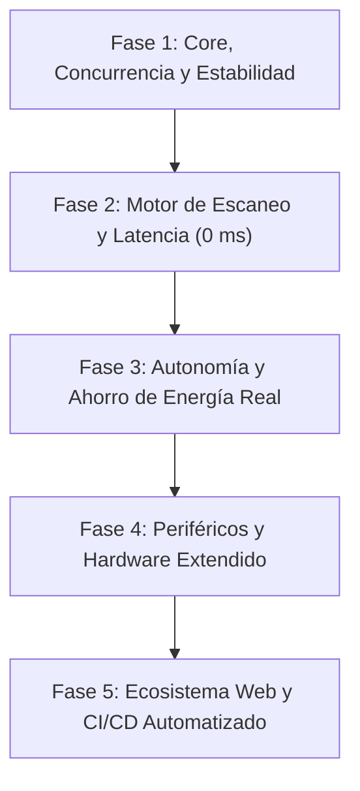
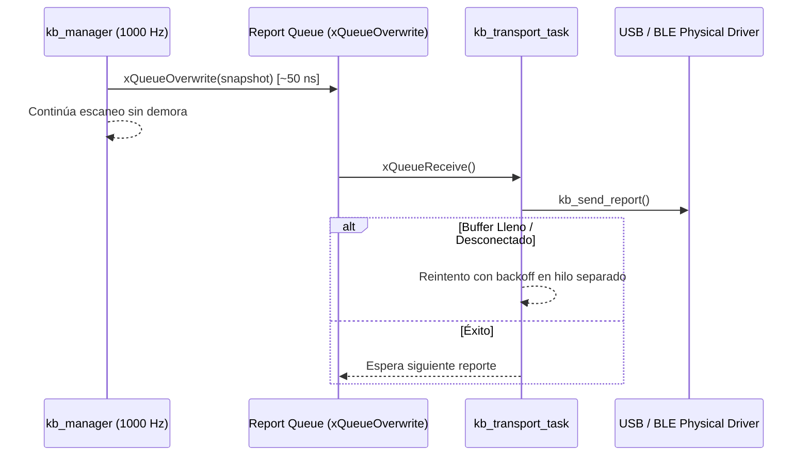
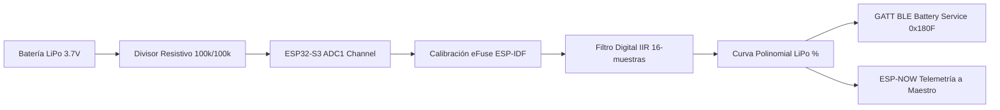
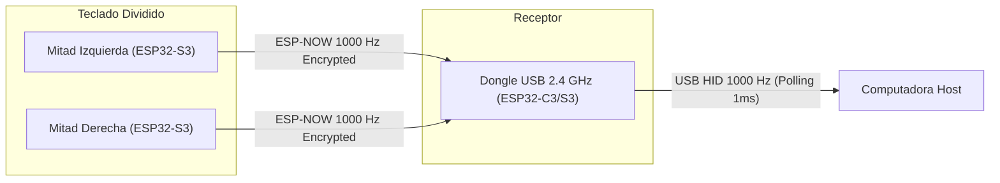
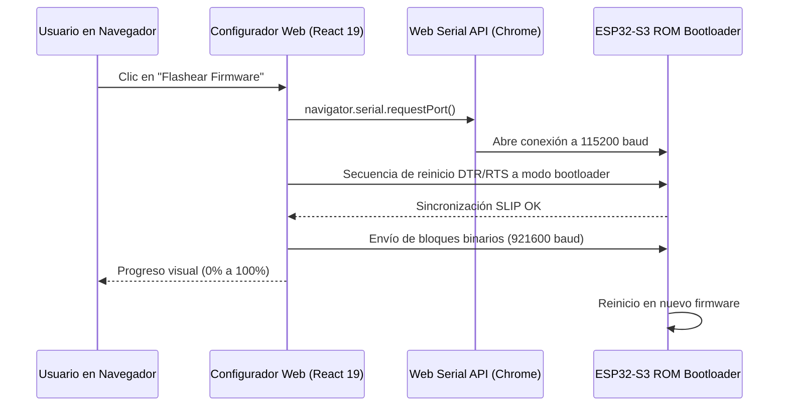
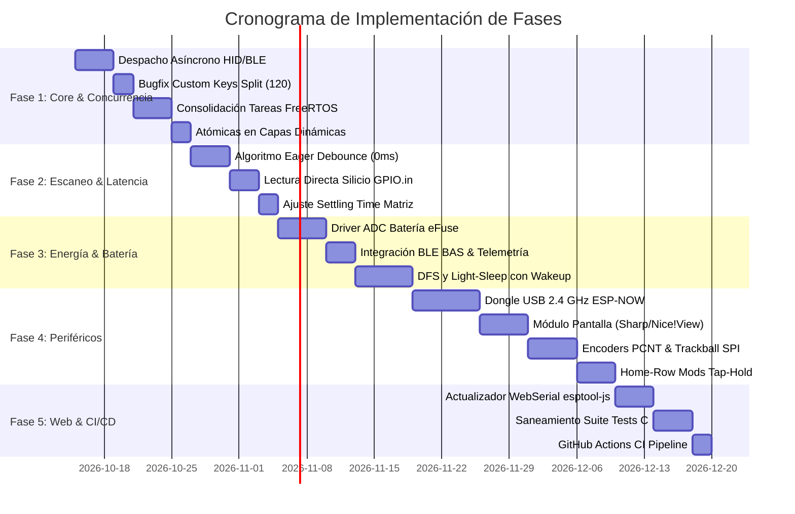

# Plan Integral de Implementación: Evolución Arquitectónica del Firmware (TEF)

> **Documento:** `FIRMWARE_EVOLUTION_IMPLEMENTATION_PLAN.md`  
> **Estado:** Propuesto / Aprobado para Planificación  
> **Rama de Trabajo:** `firmware-evolution`  
> **Plataforma Objetivo:** ESP32-S3 (Xtensa Dual-Core 240 MHz, ESP-IDF v5.5+) & Configurator (React 19 / Vite / TS)  
> **Fecha:** Octubre 2026  

---

## 1. Visión y Objetivos del Proyecto

El proyecto **Tecleados ESP Firmware (TEF)** ha consolidado las bases funcionales de un teclado mecánico ergonómico dividido (*split*) de alto nivel: transporte USB dual con NKRO nativo de 256 bits, Bluetooth LE con enrutamiento multi-perfil (NimBLE), enlace peer-to-peer cifrado sobre ESP-NOW (X25519 + AES-128-CCM), protocolo de configuración binario de alta velocidad (*Blast+Reconcile*) y un configurador web visual con soporte 3D y WebHID/WebBLE.

El objetivo de este **Plan de Implementación Integral** es transformar este prototipo avanzado en un producto de categoría industrial y competitiva (*gaming-grade* / *daily-driver wireless*), resolviendo las deudas técnicas latentes y expandiendo sus capacidades funcionales a lo largo de **5 Fases Secuenciales**:



---

## 2. Mapa de Fases y Módulos Afectados

| Fase | Componentes Principales Afectados | Objetivo Clave | Impacto Técnico |
|---|---|---|---|
| **Fase 1** | `keyboard` (`kb_manager`, `kb_macro`), `split` (`split_config_sync`), `comm_module`, `button_module` | Eliminar bloqueos síncronos de 100 ms, subsanar fuga de sincronización split y consolidar tareas FreeRTOS. | Estabilidad crítica, determinismo a 1000 Hz, menor huella de memoria DRAM. |
| **Fase 2** | `keyboard` (`kb_matrix`, `kb_manager`) | *Eager Debounce* asimétrico (latencia inicial de 0 ms) y lectura atómica de silicio (`GPIO.in`). | Respuesta competitiva gaming, reducción del uso de CPU del 36% a <8%. |
| **Fase 3** | `battery_module`, `ble_module`, `split`, Power Management (`esp_pm`) | Driver ADC LiPo real con calibración eFuse y ciclo dinámico de reloj (DFS + Light-Sleep con wake por GPIO). | Autonomía de batería extendida de 8 horas a semanas de uso continuo. |
| **Fase 4** | `dongle_module` (nuevo), `display_module` (nuevo), `encoder_module` (nuevo), `pointing_module` | Receptor USB Dongle 2.4 GHz a 1000 Hz, pantallas de estado (Sharp/Nice!View/OLED), Encoders y Home-Row Mods. | Ecosistema de hardware profesional, soporte para periféricos avanzados. |
| **Fase 5** | `configurator/` (React/TS), `test/` (Host C Mocks), `.github/workflows/` | Flasheador WebSerial in-browser (`esptool-js`), saneamiento total de la suite de tests y CI/CD en PR. | Experiencia de usuario plug-and-play sin herramientas de consola; garantía anti-regresiones. |

---

## 3. Desglose Exhaustivo por Fases

---

### FASE 1: Core del Firmware, Concurrencia y Sincronización

#### 1.1. Despacho Asíncrono No-Bloqueante de Reportes HID/BLE
* **Diagnóstico del Problema:**
  En [`components/keyboard/kb_macro.c`](file:///home/srleg/Projects/Tecleados-ESP-Firmware/components/keyboard/kb_macro.c#L78-L98), la función `kb_macro_send_report()` realiza un bucle de reintento síncrono:
  ```c
  for (int i = 0; i < 100; i++) {
      err = kb_send_report(snapshot);
      if (err == ESP_OK) break;
      vTaskDelay(pdMS_TO_TICKS(1));
  }
  ```
  Esta función es invocada de forma directa y bloqueante desde [`components/keyboard/kb_manager.c`](file:///home/srleg/Projects/Tecleados-ESP-Firmware/components/keyboard/kb_manager.c#L447) dentro del ciclo de escaneo a 1000 Hz. Si la conexión BLE experimenta congestión en la cola de paquetes o si el enlace no está completamente establecido, el escaneo de teclas físico se congela durante hasta **100 milisegundos**.
* **Diseño e Implementación:**
  1. Crear una cola de tipo buzón sobreescribible (*mailbox queue*) de longitud 1 con tamaño `sizeof(kb_report_payload_t)` utilizando `xQueueCreate(1, sizeof(kb_report_payload_t))`.
  2. Sustituir la llamada síncrona en `kb_manager` por un envío no bloqueante con `xQueueOverwrite()` (tiempo de ejecución sub-microsegundo).
  3. Crear una tarea ligera de despacho de transporte `kb_transport_task` (prioridad media, stack 3 KB) que espere en la cola mediante `xQueueReceive(..., portMAX_DELAY)`.
  4. Si el transporte falla o reporta `ESP_ERR_INVALID_STATE` (BLE desconectado o buffer lleno), la tarea de transporte gestiona el backoff de reintentos sin afectar en absoluto la velocidad de muestreo ni el registro de la matriz en `kb_manager`.



#### 1.2. Corrección del Límite de Sincronización Split (Custom Keys)
* **Diagnóstico del Problema:**
  En [`components/split/split_config_sync.c`](file:///home/srleg/Projects/Tecleados-ESP-Firmware/components/split/split_config_sync.c#L264):
  ```c
  } else if (kind == CFGMOD_KIND_CKEY && strcmp(key, "ck_idx") == 0) {
      cfg_ckey_index_t cidx = {0};
      size_t cidx_len = sizeof(cidx);
      if (cfgmod_read_storage(kind, key, &cidx, &cidx_len) == ESP_OK) {
          for (uint16_t j = 0; j < 64; j++) {  // <-- BUG CRÍTICO: Hardcodeado a 64
              if (cidx.mask[j / 8] & (1u << (j % 8))) {
  ```
  La capacidad real del sistema es de 120 claves ([`CFG_CKEYS_MAX_COUNT = 120`](file:///home/srleg/Projects/Tecleados-ESP-Firmware/components/config_module/include/cfg_custom_keys.h#L10)). Las claves entre los índices 64 y 119 nunca son sincronizadas a la mitad esclava, provocando teclas mudas en la mitad remota al usar custom keys altas.
* **Acciones:**
  1. Reemplazar la cota por `for (uint16_t j = 0; j < CFG_CKEYS_MAX_COUNT; j++)`.
  2. Verificar que la función `split_config_sync_push()` maneje adecuadamente la tasa de ráfaga para 120 llaves sin saturar el anillo de transmisión ESP-NOW, agregando un `vTaskDelay(pdMS_TO_TICKS(1))` cada 8 paquetes empujados.

#### 1.3. Consolidación de Tareas FreeRTOS y Migración a Temporizadores
* **Diagnóstico del Problema:**
  El firmware instancia hasta 16 tareas concurrentes. Particularmente:
  - `comm_timeouts_task` en [`components/comm_module/comm_dispatch.c`](file:///home/srleg/Projects/Tecleados-ESP-Firmware/components/comm_module/comm_dispatch.c#L143-L160) duerme continuamente 5 ms en un bucle `while(1)` consumiendo 4 KB de stack únicamente para evaluar dos marcas de tiempo (`s_rx_last_packet_us`).
  - El sistema de Tap-Hold en [`components/keyboard/kb_macro.c`](file:///home/srleg/Projects/Tecleados-ESP-Firmware/components/keyboard/kb_macro.c) genera 4 tareas worker separadas `kb_tap_0..3` (3 KB de stack cada una = 12 KB).
* **Acciones:**
  1. **Eliminación de `comm_timeouts_task`**: Sustituir el bucle de sondeo por un temporizador de software de ESP-IDF (`esp_timer_create`). El timer de timeout de 100 ms se inicia (`esp_timer_start_once`) únicamente al recibir el primer fragmento de ráfaga en `comm_rx.c`, y se detiene automáticamente al completar la transacción o disparar el reset de protocolo.
  2. **Unificación de Workers de Tap-Hold**: Reemplazar las 4 tareas independientes de tap-hold por una única tarea worker con una cola de eventos o por temporizadores de FreeRTOS (`TimerCallbackFunction_t`), liberando más de 9 KB de memoria DRAM interna.

#### 1.4. Protección de Concurrencia en Capas Dinámicas
* **Diagnóstico del Problema:**
  En [`components/keyboard/kb_macro.c`](file:///home/srleg/Projects/Tecleados-ESP-Firmware/components/keyboard/kb_macro.c#L427-L435), las variables de estado de capa `s_momentary_layers` y `s_toggled_layers` son accedidas y modificadas concurrentemente desde múltiples contextos de ejecución (escaneo de matriz, tareas de macros y tareas de tap) mediante operaciones de asignación bitwise no atómicas.
* **Acciones:**
  1. Convertir `s_momentary_layers` y `s_toggled_layers` a tipos atómicos estándar C11 (`atomic_uint_least16_t` de `<stdatomic.h>`), utilizando `atomic_fetch_or_explicit()`, `atomic_fetch_and_explicit()` y `atomic_fetch_xor_explicit()` con orden de memoria `memory_order_relaxed`.
  2. Esto garantiza operaciones libres de contención de cerrojos (*lock-free*) y libres de condiciones de carrera a nivel de instrucción de CPU.

#### 1.5. Desacoplamiento Seguro de la Instalación de ISRs
* **Diagnóstico del Problema:**
  [`components/keyboard/kb_matrix.c`](file:///home/srleg/Projects/Tecleados-ESP-Firmware/components/keyboard/kb_matrix.c#L166) asume que [`components/button_module/button.c`](file:///home/srleg/Projects/Tecleados-ESP-Firmware/components/button_module/button.c#L128) ya llamó a `gpio_install_isr_service(0)`.
* **Acciones:**
  1. En `kb_matrix_init_isr()`, invocar preventivamente `gpio_install_isr_service(0)` e ignorar el código de retorno `ESP_ERR_INVALID_STATE` (el cual indica que el servicio ya estaba previamente instalado). Esto permite que el módulo `keyboard` sea autosuficiente en compilaciones modulares o suites de test.

---

### FASE 2: Motor de Escaneo y Reducción de Latencia a Nivel Competitivo

#### 2.1. Algoritmo de Eager Debouncing (0 ms de Latencia Inicial)
* **Diagnóstico del Problema:**
  En [`components/keyboard/kb_manager.c`](file:///home/srleg/Projects/Tecleados-ESP-Firmware/components/keyboard/kb_manager.c#L38-L41), el debouncer integrativo exige `KB_DEBOUNCE_SCANS = 5` consecutivas tanto para registrar la pulsación como para la liberación:
  $$\text{Latencia de Entrada} = 5 \text{ escaneos} \times 1\text{ ms} = 5\text{ ms}$$
* **Diseño e Implementación de Eager Debounce:**
  1. **Disparo Inmediato (0 ms Lag):** En cuanto una tecla pasa de inactiva a activa en el primer escaneo, el evento de pulsación se emite de inmediato al mapa de NKRO sin esperar ciclos de confirmación.
  2. **Ventana de Supresión Reactiva (*Eager Lockout*):** Tras emitir el evento, se congela el estado de esa tecla durante una ventana fija configurable de 5 ms (5 ciclos). Cualquier fluctuación o rebote electromecánico posterior durante esa ventana es ignorado.
  3. **Liberación con Filtrado:** La liberación de la tecla requiere que se detecte liberada durante 3 a 5 ciclos consecutivos antes de enviar el evento de *release*, evitando liberaciones prematuras accidentales.

```
Pulsación Física:   ---\_/\_/\------------------------------------/\_/\_----/---
Estado Tradicional: ----------[5ms Delay]=========================[5ms]--------
Eager Debounce:     ---[0ms DISPARO!]=============================[Filtro]-----
```

#### 2.2. Lectura Directa de Registros de Silicio (`GPIO.in`)
* **Diagnóstico del Problema:**
  En [`components/keyboard/kb_matrix.c`](file:///home/srleg/Projects/Tecleados-ESP-Firmware/components/keyboard/kb_matrix.c#L78-L84), por cada una de las 18 columnas se leen las filas una a una llamando a `gpio_get_level()`:
  $$18 \text{ columnas} \times 6 \text{ filas} = 108 \text{ llamadas a función por ciclo de 1 ms}$$
* **Acciones:**
  1. En lugar de iterar llamando a wrappers de la ROM de Espressif, realizar una lectura directa del registro de entrada de 32 bits del ESP32-S3:
     ```c
     uint32_t gpio_in_low  = GPIO.in;
     uint32_t gpio_in_high = GPIO.in1.data;
     ```
  2. Extraer los estados de las filas aplicando máscaras de bits precomputadas (`s_row_mask_low` y `s_row_mask_high`) en una única operación de ensamblador Xtensa.

#### 2.3. Sintonización del Tiempo de Asentamiento (*Settling Time*)
* **Diagnóstico del Problema:**
  [`components/keyboard/kb_matrix.c#L76`](file:///home/srleg/Projects/Tecleados-ESP-Firmware/components/keyboard/kb_matrix.c#L76) espera 20 µs tras seleccionar cada columna (`esp_rom_delay_us(20)`), lo que consume $18 \times 20\,\mu\text{s} = 360\,\mu\text{s}$ por milisegundo en tiempo de CPU inútil (36% del núcleo).
* **Acciones:**
  1. Reducir el retardo a un valor seguro de 5 a 8 µs (suficiente para que la capacitancia parásita de trazas de PCB estándar de teclados se estabilice con resistencias de pull-up internas de 45 kΩ).
  2. Recuperar más del 25% de tiempo de CPU para tareas de criptografía y comunicación.

---

### FASE 3: Autonomía de Batería y Eficiencia Energética Real

#### 3.1. Driver Real de Batería con Calibración ADC por eFuse
* **Diagnóstico del Problema:**
  En [`components/battery_module/battery.c`](file:///home/srleg/Projects/Tecleados-ESP-Firmware/components/battery_module/battery.c#L10), la función devuelve el valor fijo `0xFF`.
* **Diseño e Implementación:**
  1. **Configuración de Periférico:** Configurar la unidad ADC1 del ESP32-S3 usando la API moderna de ESP-IDF `esp_adc/adc_oneshot.h`.
  2. **Atenuación y Calibración:** Configurar atenuación de 12 dB (`ADC_ATTEN_DB_12`) para permitir lecturas hasta ~3100 mV, utilizando los coeficientes de calibración de fábrica grabados en eFuse (`esp_adc_cal_characterize`).
  3. **Divisor Resistivo de Hardware:** Modelar la lectura en base a un divisor resistivo estándar (ej. 2x resistencias de 100 kΩ con condensador de 100 nF a tierra, factor divisor 2.0).
  4. **Curva de Descarga LiPo (Lookup Table):** Mapear el voltaje leído contra una curva no lineal de LiPo (4.20 V = 100%, 3.85 V = 50%, 3.60 V = 10%, 3.30 V = 0% de corte) con filtro paso-bajo IIR de 16 muestras para eliminar ruido electromagnético.
  5. **Integración con BLE BAS:** Publicar periódicamente (cada 60 segundos o ante cambios $\ge 2\%$) la notificación GATT al host Bluetooth mediante el servicio estándar BAS (UUID `0x180F`).
  6. **Sincronización Split:** Enviar el porcentaje de batería de la mitad esclava a la mitad maestra mediante un nuevo paquete de telemetría ESP-NOW periódico.



#### 3.2. Dynamic Frequency Scaling (DFS) y Modo Light-Sleep con Despertar GPIO
* **Diagnóstico del Problema:**
  [`components/split/split_task.c#L86`](file:///home/srleg/Projects/Tecleados-ESP-Firmware/components/split/split_task.c#L86) fuerza el microcontrolador a correr permanentemente a 240 MHz con `light_sleep_enable = false`.
* **Diseño del Gestor de Energía (`power_mgr`):**
  Implementar una máquina de estados de energía con 4 niveles:

| Estado de Energía | Frecuencia CPU | Radio BLE / ESP-NOW | Modo de Reposo | Consumo Estimado | Condición de Entrada / Salida |
|---|---|---|---|---|---|
| **ACTIVE** | 240 MHz / 160 MHz | Activos (Conexión continua) | Ninguno | ~65 - 80 mA | Teclas activas o tráfico USB/BLE en curso. |
| **IDLE** | 80 MHz | BLE en ventana de conexión; ESP-NOW activo | Tickless Idle | ~15 - 20 mA | Sin pulsaciones durante 5 segundos. Despierta en <10 µs ante tecla. |
| **LIGHT SLEEP** | Reloj APB suspendido | Radio periódica (DTIM / Intervalo BLE 30-50 ms) | `light_sleep_enable = true` | **~1.5 - 2.5 mA** | Sin pulsaciones durante 30 segundos. Despierta por interrupción GPIO negedge en filas. |
| **DEEP SLEEP** | Silicio apagado (solo RTC) | Radios apagadas | Deep Sleep | **< 20 µA** | Inactividad prolongada (> 15 minutos). Despierta por cualquier tecla (RTC GPIO Wakeup) reiniciando por boot vector. |

---

### FASE 4: Nuevas Prestaciones de Hardware y Periféricos

#### 4.1. Receptor Dongle USB Dedicado a 2.4 GHz (ESP-NOW Host)
* **Objetivo:**
  Proporcionar una conexión inalámbrica *gaming-grade* de 1000 Hz reales y latencia <1.5 ms a la PC, eludiendo las limitaciones de sondeo de Bluetooth LE (que típicamente impone intervalos de conexión de 8 a 15 ms con jitter).
* **Arquitectura:**
  1. **Hardware:** Sub-proyecto de firmware ligero para un ESP32-C3 o ESP32-S3 Mini montado en conector USB-A macho.
  2. **Rol en la Red:** El Dongle se registra como receptor maestro ESP-NOW. Ambas mitades (izquierda y derecha) operan como nodos emisores sincronizados con la clave TSK del dongle.
  3. **Dispositivo Compuesto USB:** El dongle expone endpoints USB nativos idénticos al firmware principal:
     - Endpoint HID 1: Teclado NKRO 1000 Hz.
     - Endpoint HID 2: Ratón / Consumo (Consumer Keys).
     - Endpoint HID 3: Canal WebHID para el configurador.



#### 4.2. Módulo de Pantalla de Estado Ultra-Bajo Consumo (`display_module`)
* **Hardware Soportado:**
  - Pantallas de memoria ultra-eficientes tipo **Sharp Memory LCD** (ej. LS027B7DH01) o **Nice!View** (consumo < 10 µA en imagen estática).
  - Pantallas OLED estándar **SSD1306** (128x32 o 128x64) por I2C.
* **Información Visual a Renderizar:**
  - Capa activa actual (Base, Nav, Num, Sym, Gaming).
  - Nivel de batería porcentual de la mitad local y de la mitad remota.
  - Perfil de conexión BLE activo (1 a 9) o indicador de modo USB / Dongle.
  - Indicador de bloqueo de mayúsculas (Caps Lock).
  - Métrica de velocidad de escritura en tiempo real (**WPM** - palabras por minuto).
  - Latencia de ping RTT entre mitades en milisegundos (provista por `split_bench`).

#### 4.3. Soporte para Encoders Rotatorios y Sensores Señaladores
* **Encoders Rotatorios (Volumen, Scroll, Zoom):**
  - Implementación sobre el periférico de hardware **PCNT (Pulse Counter)** del ESP32-S3. La decodificación en cuadratura se ejecuta en hardware puro sin consumir interrupciones ni tiempo de CPU.
  - Mapeo configurable en el layout para emitir teclas multimedia estándar (`CONSUMER_VOLUME_UP`, `CONSUMER_VOLUME_DOWN`) o pulsaciones de macros.
* **Sensores de Ratón / Trackball:**
  - Driver SPI para sensores ópticos de alta precisión tipo **PMW3360** / **PMW3389**.
  - Tarea dedicada que sondea el registro de movimiento a 500 Hz y emite reportes estándar HID Mouse (deltas X, Y, botones).

#### 4.4. Motor de "Home-Row Mods" y Mod-Tap Nativo en Matriz
* **Objetivo:**
  Permitir que las teclas principales del área de descanso dactilar (*home row*, ej. `A`, `S`, `D`, `F`) emitan la letra al pulsarse brevemente, pero actúen como modificadores (`GUI`, `ALT`, `CTRL`, `SHIFT`) al mantenerse presionadas.
* **Reglas Lógicas a Implementar en `kb_macro`:**
  - **Tapping Term:** Umbral de tiempo configurable (default: 200 ms).
  - **Permissive Hold:** Si se presiona otra tecla mientras la tecla tap-hold está retenida y se libera esa otra tecla dentro del tapping term, se decide inmediatamente por la función de modificador.
  - **Hold On Other Key Press:** Disparo determinista de modificador al interactuar con teclas adyacentes.

---

### FASE 5: Ecosistema Web y Automatización CI/CD

#### 5.1. Actualizador de Firmware WebSerial In-Browser (`esptool-js`)
* **Objetivo:**
  Permitir al usuario final actualizar el firmware del teclado o borrar las particiones NVS directamente desde el navegador (Google Chrome / Edge) sin instalar Python, Git ni la toolchain de ESP-IDF.
* **Implementación en el Configurador Web:**
  1. Instalar la librería oficial `@espressif/esptool-js` en el proyecto Vite.
  2. Agregar un modal interactivo en el configurador "Actualizar Firmware":
     - Detección de puerto serie USB CDC mediante la API Web Serial (`navigator.serial`).
     - Selección de versión de firmware desde GitHub Releases o carga manual de archivo `.bin`.
     - Flasheo de particiones `bootloader.bin` (0x0000), `partition-table.bin` (0x8000) y `tecleados_firmware.bin` (0x10000) con barra de progreso interactiva en tiempo real.



#### 5.2. Saneamiento Integral de la Suite de Pruebas Unitarias (`test/`)
* **Diagnóstico del Problema:**
  La suite de pruebas en host local (`test/`) no compila debido a:
  - Rutas obsoletas e inclusiones inexistentes de `usb_module` en [`test/main.c`](file:///home/srleg/Projects/Tecleados-ESP-Firmware/test/main.c).
  - Firmas de funciones desactualizadas en [`test/usb/test_usb_rx.c`](file:///home/srleg/Projects/Tecleados-ESP-Firmware/test/usb/test_usb_rx.c) (`process_rx_request` cambiada a `comm_process_rx_request`).
  - Constantes de capas estáticas ya eliminadas (`KB_LAYER_FN1`, `SYS_ACTION_LAYER_FN1`) en [`test/keyboard/test_kb_layout.c`](file:///home/srleg/Projects/Tecleados-ESP-Firmware/test/keyboard/test_kb_layout.c).
* **Acciones:**
  1. **Actualizar Mocks de FreeRTOS y ESP-IDF:** Adaptar los headers simulados en `test/include/` para reflejar la API de ESP-IDF v5.5.
  2. **Refactorizar Tests de Layouts:** Reescribir `test_kb_layout.c` para utilizar la nueva API de capas dinámicas basadas en máscaras de 16 bits (`s_momentary_layers` / `s_toggled_layers`).
  3. **Automatizar Script de Compilación:** Corregir [`test/run_tests.sh`](file:///home/srleg/Projects/Tecleados-ESP-Firmware/test/run_tests.sh) asegurando que incluya todos los flags de include `-I../components/...` necesarios para compilar limpiamente bajo GCC nativo en Linux y macOS.

#### 5.3. Pipeline Automatizado de Integración Continua (CI/CD)
* **Archivo de Configuración:** `.github/workflows/ci.yml`
* **Etapas del Pipeline:**
  1. **Job 1 (Host Unit Tests):** Compilación y ejecución de la suite de tests en host en un runner `ubuntu-latest` mediante GCC.
  2. **Job 2 (ESP-IDF Firmware Build):** Utilización de la imagen oficial Docker de Espressif (`espressif/idf:v5.5`) para compilar los targets de hardware (`idf.py build`) validando que no existan advertencias ni desbordamientos de memoria DRAM.
  3. **Job 3 (Configurator Lint & Build):** Ejecución de `npm run lint` y `npm run build` en el directorio `configurator/` para asegurar que las definiciones TypeScript concuerden con los esquemas binarios del firmware.

---

## 4. Cronograma de Ejecución y Dependencias Técnicas



---

## 5. Matriz de Validación y Criterios de Aceptación

| Métrica / Prueba | Estado Actual (Línea Base) | Objetivo de Aceptación (Post-Implementación) | Método de Medición |
|---|---|---|---|
| **Latencia de Escaneo de Pulsación** | 5.0 ms (Filtro simétrico 5 ciclos) | **< 0.5 ms (Eager Debounce 0 ms)** | Analizador lógico Saleae en interruptor físico vs paquete USB SOF. |
| **Tiempo de Bloqueo por Desconexión** | Hasta 100 ms síncrono en bucle | **0 ms (Despacho no-bloqueante por cola)** | Profiler de ejecución de tareas FreeRTOS / Traza de `vTaskDelay`. |
| **Sincronización Custom Keys Split** | Limitado a 64 claves | **120 claves completas sincronizadas** | Test de ráfaga y verificación de memoria NVS en mitad esclava. |
| **Consumo de Batería en Reposo** | ~70 mA (Reloj fijo a 240 MHz) | **< 2.5 mA en Light Sleep (< 20 µA Deep)** | Multímetro digital de precisión / Nordic Power Profiler Kit II. |
| **Reporte de Batería en Sistema** | Valor constante `0xFF` | **0 a 100% calibrado por eFuse** | Inspección de servicio BLE BAS en Bluetooth Explorer / OS Battery Widget. |
| **Latencia Inalámbrica de Escritura** | 8 a 15 ms (Intervalo de conexión BLE) | **< 1.5 ms con Dongle USB 2.4 GHz** | Sondeo de paquetes HID de 1000 Hz sobre ESP-NOW. |
| **Compilación de Tests en Host** | Falla de compilación por bitrot | **100% de tests pasando en GCC (`run_tests.sh`)** | Ejecución local y verificación en pipeline de GitHub Actions. |

---

## 6. Siguientes Pasos Inmediatos

1. Aprobar la estructura de fases y dependencias detallada en este documento.
2. Iniciar la ejecución de la **Fase 1** comenzando con el desacoplamiento asíncrono en [`kb_macro.c`](file:///home/srleg/Projects/Tecleados-ESP-Firmware/components/keyboard/kb_macro.c) y la corrección del bucle de claves en [`split_config_sync.c`](file:///home/srleg/Projects/Tecleados-ESP-Firmware/components/split/split_config_sync.c).
3. Mantener los cambios agrupados por *commits* atómicos dentro de la rama `firmware-evolution`.
